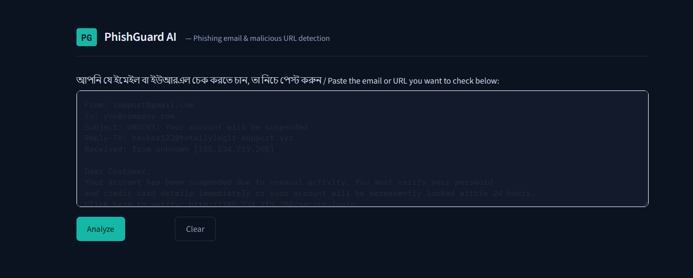

# 🛡️ PhishGuard AI — Email & Malicious URL Threat Detection Engine

---

## 👥 Contributors

This academic project was developed by:

- **Mohibul Islam** (Roll: `38`) — *Project Lead & Lead Systems Architect / ML & Security Integrations*
- **Nazmul** (Roll: `16`) — *Data Processing & Heuristics Rule Engine*
- **Riaz** (Roll: `44`) — *UI/UX & PDF Generation Pipeline*

---

PhishGuard AI is an enterprise-grade threat detection system built with **Streamlit**, **Python**, and **Machine Learning**. It analyzes raw email headers, body text, attached email files, and embedded URLs to generate real-time security risk assessments, threat mapping, and SOC-style diagnostic reports.

🌐 **Live Application:** [phishing-email-and-url-detection-system.streamlit.app](https://phishing-email-and-url-detection-system.streamlit.app/)

---

## 📸 System Preview



---

## 🌟 Key Features

- **Multi-Model Hybrid Ensemble Engine:** Combines Weighted Heuristics, Random Forest, Naive Bayes, and LightGBM for balanced classification accuracy.
- **Real-Time Threat Intelligence (VirusTotal v3):** Live query against VirusTotal's global database of 70+ security vendors with automated background URL scan submission (`404` handling).
- **Origin Location Tracking (GeoIP Map):** Interactive Leaflet (`folium`) world map visualizing sender IP/Domain origins, ISP details, and geographic locations.
- **Raw Email File Parser (.eml / .msg):** Direct file upload support to extract headers, sender routing paths, email body content, and embedded hyperlinks automatically.
- **Deep URL & Domain Inspection:** Analyzes raw link structures, suspicious TLDs, IP-based URLs, shorteners, and redirection anomalies.
- **Header Threat Parser:** Extracts SPF/DKIM data and flags sender identity mismatch (`From` vs `Reply-To`).
- **Interactive SOC-style UI:** Modern dark-themed threat radar dashboard designed with custom CSS and crash-proof rerender state management.
- **Exportable Security Reports:** Generates standard PDF threat reports via `ReportLab` with a single click.

---

## 🏗️ Project Architecture

```text
Phishing-Email-and-URL-Detection-System/
├── app.py                   # Main Streamlit Dashboard UI
├── config.py                # System thresholds, ML weights & global settings
├── requirements.txt         # Project dependencies
├── README.md                # Project documentation
├── LICENSE                  # Open-source license
├── .gitignore               # Git untracked files configuration
│
├── data/
│   └── dataset.csv          # Training dataset for ML models
│
├── models/
│   ├── phishing_model.pkl   # Pre-trained ML classifier
│   └── vectorizer.pkl       # TF-IDF feature extractor
│
├── src/
│   ├── __init__.py
│   ├── preprocessing.py     # Text cleaning & extraction routines
│   ├── features.py          # Feature engineering logic
│   ├── url_analysis.py      # Core URL threat analyzer
│   ├── header_analysis.py   # Email header parser
│   ├── rules.py             # Heuristic rules engine
│   ├── ensemble.py          # Hybrid classification voter
│   └── train_model.py       # ML model training script
│
├── tests/                   # Automated unit test suite
│   ├── test_rules.py
│   ├── test_ensemble.py
│   └── test_url_analysis.py
│
├── reports/                 # Output directory for exported PDF reports
└── assets/                  # UI previews, screenshots & brand assets

## 🛠️ Tech Stack & Dependencies

- **Core Language:** Python 3.10+
- **Framework & UI:** Streamlit, Custom CSS
- **Mapping & Visualization:** `folium`, `streamlit-folium`
- **Threat Intelligence & Network:** VirusTotal v3 REST API, `GeoIP (ip-api.com)` Services, `requests`
- **Machine Learning & Processing:** `scikit-learn`, `pandas`, `numpy`
- **Email Parsing & PDF:** Native Python `email` module, `ReportLab`